# FraudDetect AI

### Credit Card Fraud Detection Using Machine Learning


---

## 1. Project Overview

FraudDetect AI is an end-to-end machine learning research
project focused on credit card fraud detection.

The main objective is to investigate how different machine
learning algorithms, class imbalance strategies,
hyperparameter configurations and decision thresholds
influence fraud detection performance.

The project covers the complete machine learning lifecycle,
from exploratory data analysis to final model evaluation
and model export.

### Project Highlights

| Indicator | Value |
|---|---:|
| Original transactions | 284,807 |
| Original fraudulent transactions | 492 |
| Predictive features | 30 |
| Machine learning algorithms | 6 |
| Training strategies | 5 |
| Initial model configurations | 28 |
| Optimized configurations | 3 |
| Total configurations evaluated | 31 |
| Python scripts | 18 |

---

## 2. Dataset

The project uses the Credit Card Fraud Detection dataset.

Dataset source:

[Credit Card Fraud Detection - Kaggle](https://www.kaggle.com/datasets/mlg-ulb/creditcardfraud)

The original dataset contains 284,807 credit card
transactions, including 492 fraudulent transactions.

Only approximately 0.173% of the original transactions
are fraudulent, making this a highly imbalanced binary
classification problem.

### Features

| Feature | Description |
|---|---|
| Time | Time elapsed since the first transaction |
| Amount | Transaction amount |
| V1 - V28 | Anonymized PCA components |
| Class | Target variable: legitimate or fraudulent |

Target classes:

- 0: Legitimate transaction
- 1: Fraudulent transaction

### Class Distribution

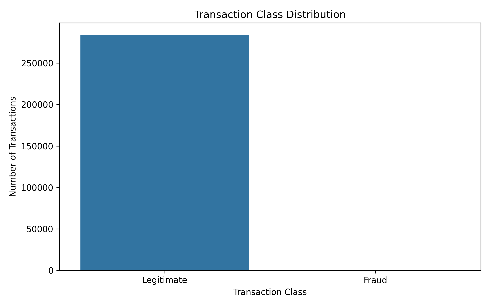

### Feature Correlation Analysis

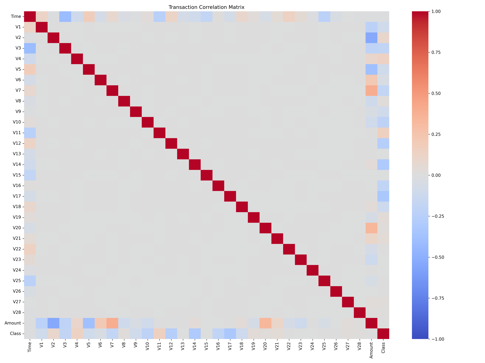

---

## 3. Machine Learning Pipeline

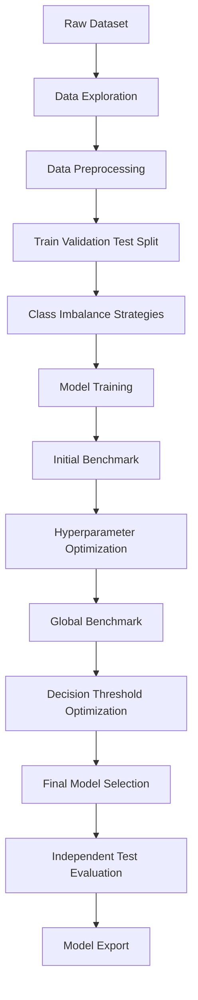

The test dataset was reserved for final evaluation.
Model selection and threshold optimization were performed
using validation data.

---

## 4. Class Imbalance Management

Five training strategies were investigated:

| Strategy | Description |
|---|---|
| Original | Training with the original class distribution |
| Balanced | Class weighting |
| Undersampling | Reducing the majority class |
| Oversampling | Increasing the minority class through resampling |
| SMOTE | Generating synthetic minority-class samples |

Not every strategy was applicable to every algorithm.

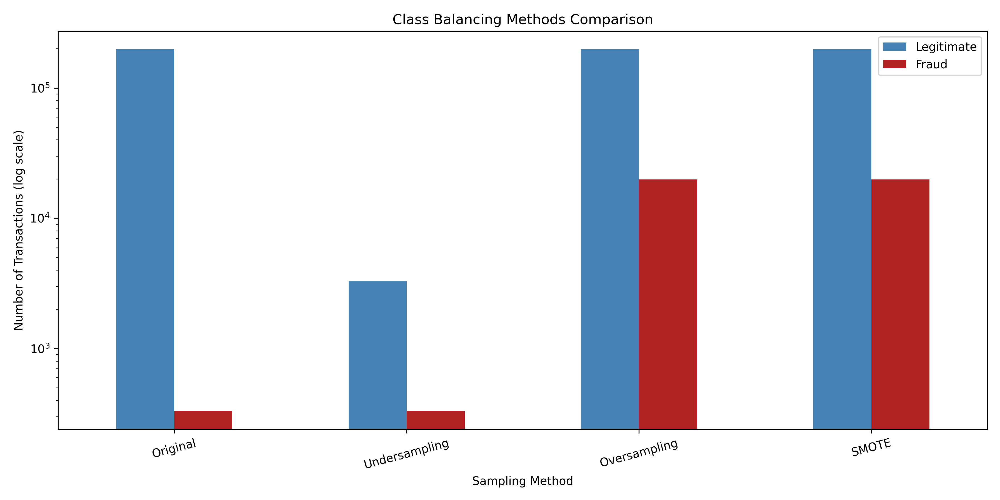

---

## 5. Machine Learning Algorithms

Six machine learning algorithms were implemented:

| Algorithm | Category |
|---|---|
| Logistic Regression | Linear classification |
| Decision Tree | Tree-based classification |
| K-Nearest Neighbors | Instance-based learning |
| Random Forest | Ensemble learning |
| XGBoost | Gradient boosting |
| Neural Network | Multilayer Perceptron |

A total of 28 initial model configurations were trained
and evaluated.

Three additional configurations were generated through
hyperparameter optimization.

---

## 6. Evaluation Metrics

Accuracy alone is insufficient for highly imbalanced
classification problems.

The following metrics were considered:

- Precision
- Recall
- F1-score
- F2-score
- Average Precision
- ROC-AUC
- Balanced Accuracy
- Matthews Correlation Coefficient
- Confusion Matrix
- Prediction Time
- Model Size

Average Precision was used for the initial global
benchmark.

F2-score was used as the main criterion for final model
and decision threshold selection, emphasizing fraud recall.

---

## 7. Global Model Benchmark

Best validation Average Precision by algorithm:

| Rank | Algorithm | Strategy | Average Precision |
|---:|---|---|---:|
| 1 | XGBoost | Balanced | 85.24% |
| 2 | Random Forest | Balanced | 84.83% |
| 3 | Neural Network | Oversampling | 80.29% |
| 4 | KNN | Original | 79.34% |
| 5 | Decision Tree | Original | 71.62% |
| 6 | Logistic Regression | Undersampling | 70.65% |

### Global Ranking

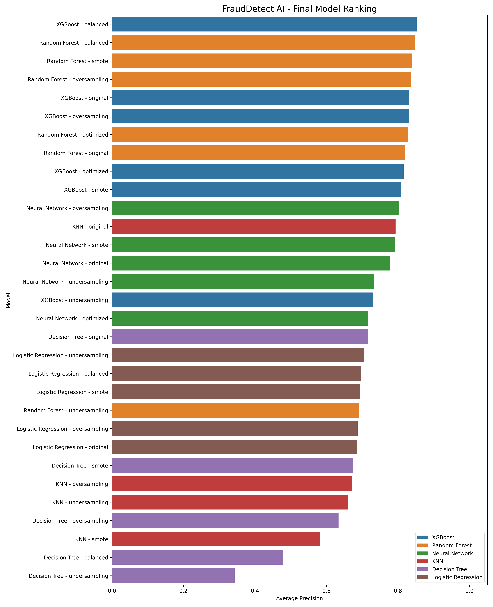

### Performance Heatmap

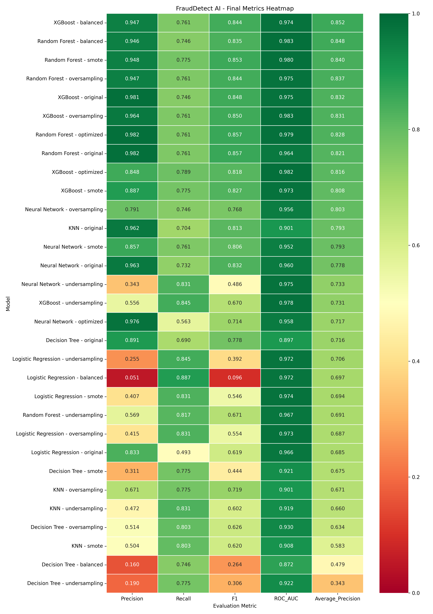

### Performance and Prediction Speed

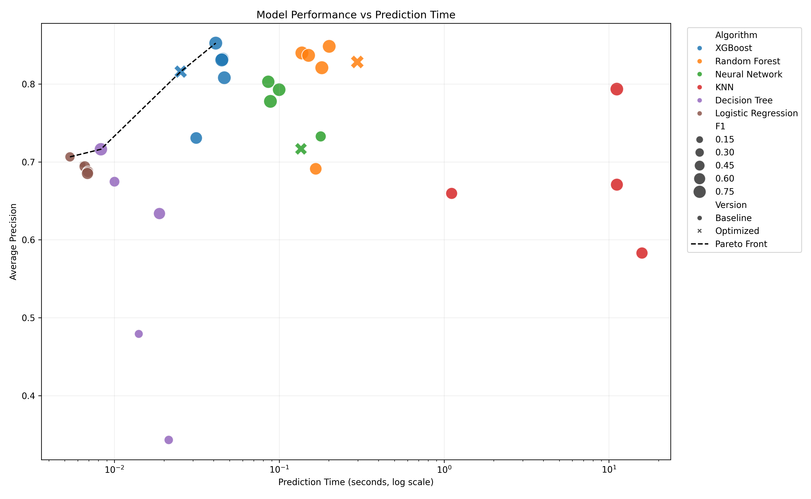

The complete benchmark results are available in:

[Global Benchmark CSV](reports/final_benchmark/global_benchmark.csv)

---

## 8. Hyperparameter Optimization

Hyperparameter optimization was performed on three
machine learning algorithms:

- XGBoost
- Random Forest
- Neural Network

Validation Average Precision comparison:

| Algorithm | Initial | Optimized |
|---|---:|---:|
| XGBoost | 85.24% | 81.58% |
| Random Forest | 84.83% | 82.83% |
| Neural Network | 80.29% | 71.67% |

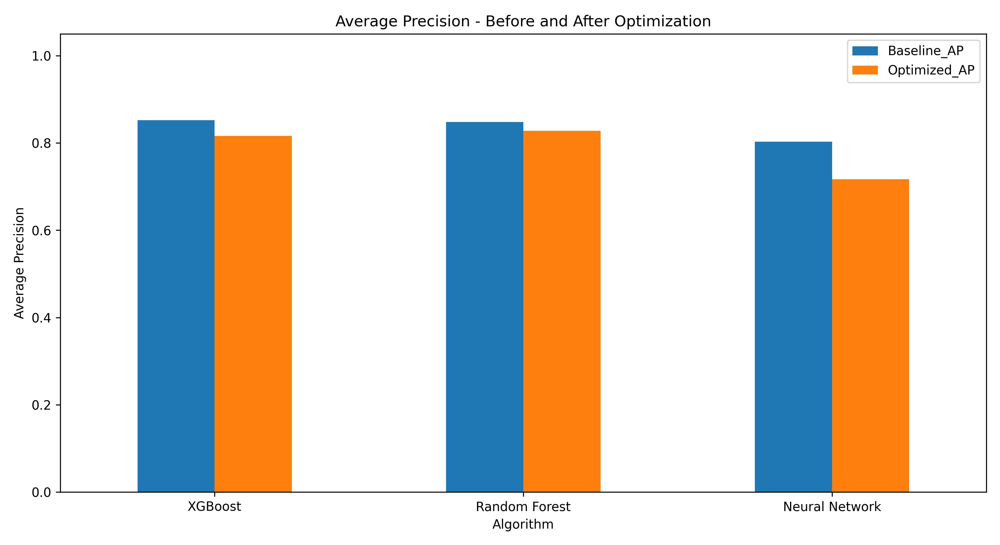

The experiments demonstrate that hyperparameter tuning
does not necessarily improve validation performance.

The best initial configurations were therefore retained
as candidates for final model selection.

---

## 9. Decision Threshold Optimization

Instead of relying exclusively on the default
classification threshold of 0.5, multiple decision
threshold strategies were evaluated:

- Default threshold
- Maximum F1-score
- Maximum F2-score
- Minimum precision constraint
- Minimum recall constraint
- Minimum hypothetical error cost

The final configuration was selected by maximizing
the F2-score on the validation dataset.

### Selected Model

| Parameter | Value |
|---|---|
| Algorithm | Random Forest |
| Training strategy | Balanced |
| Selection criterion | F2-score |
| Decision threshold | 0.245777596816 (rounded) |

### Threshold Optimization Results

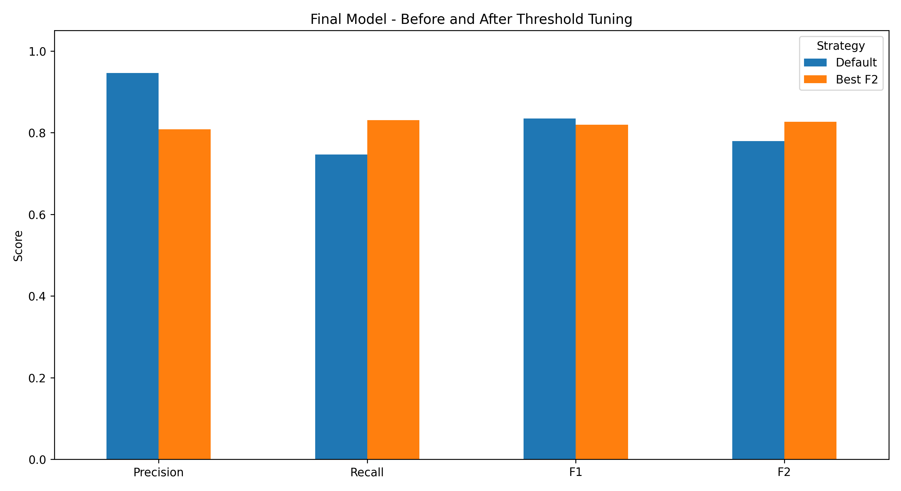

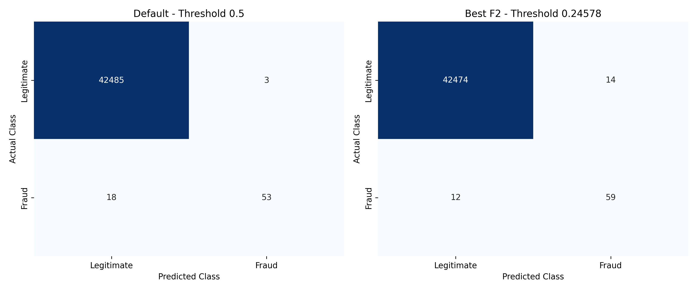

On the validation dataset, threshold optimization
increased the number of detected frauds from 53 to 59.

---

## 10. Final Model Evaluation

The selected Random Forest model was evaluated on
42,559 test transactions, including 71 fraudulent
transactions.

No additional training or threshold optimization was
performed on the test dataset.

### Final Test Results

| Metric | Score |
|---|---:|
| ROC-AUC | 95.04% |
| Average Precision | 79.49% |
| Precision | 73.68% |
| Recall | 78.87% |
| F1-score | 76.19% |
| F2-score | 77.78% |

### Confusion Matrix

| Actual / Predicted | Legitimate | Fraud |
|---|---:|---:|
| Legitimate | 42,468 | 20 |
| Fraud | 15 | 56 |

The final model detected 56 out of 71 fraudulent
transactions.

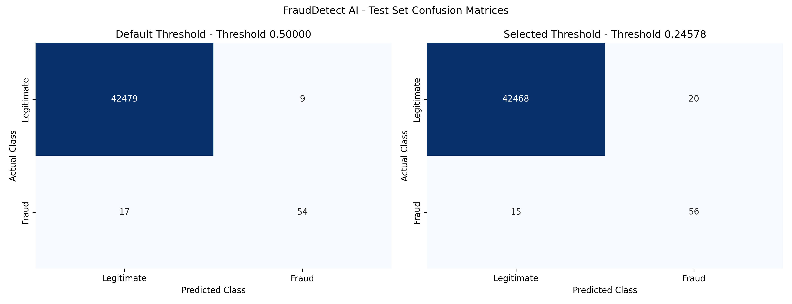

### Precision-Recall Curve

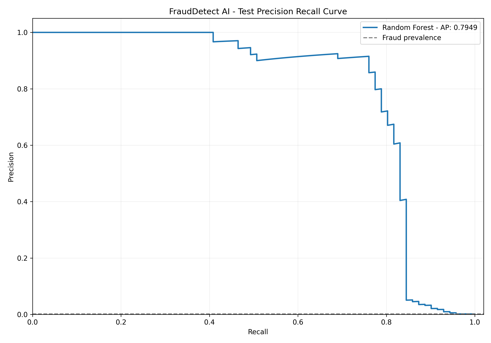

### ROC Curve

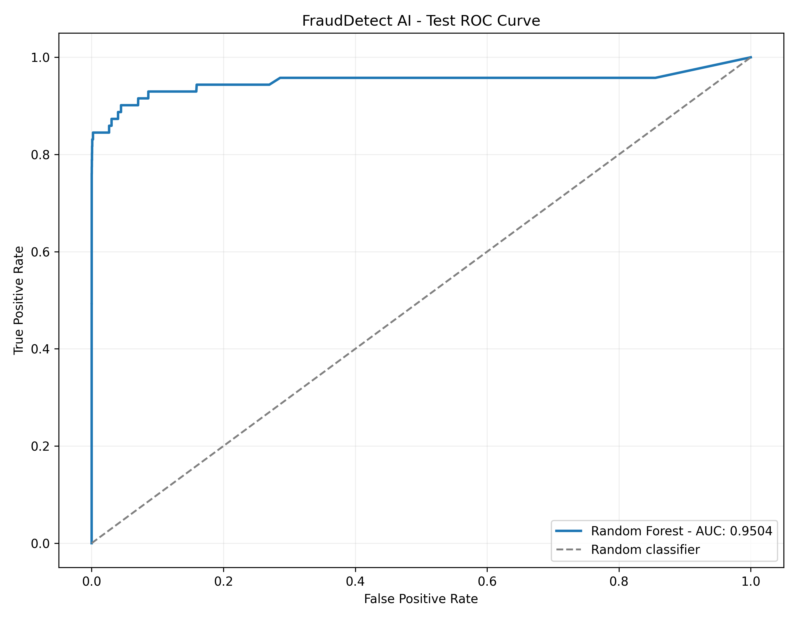

### Validation vs Test Performance

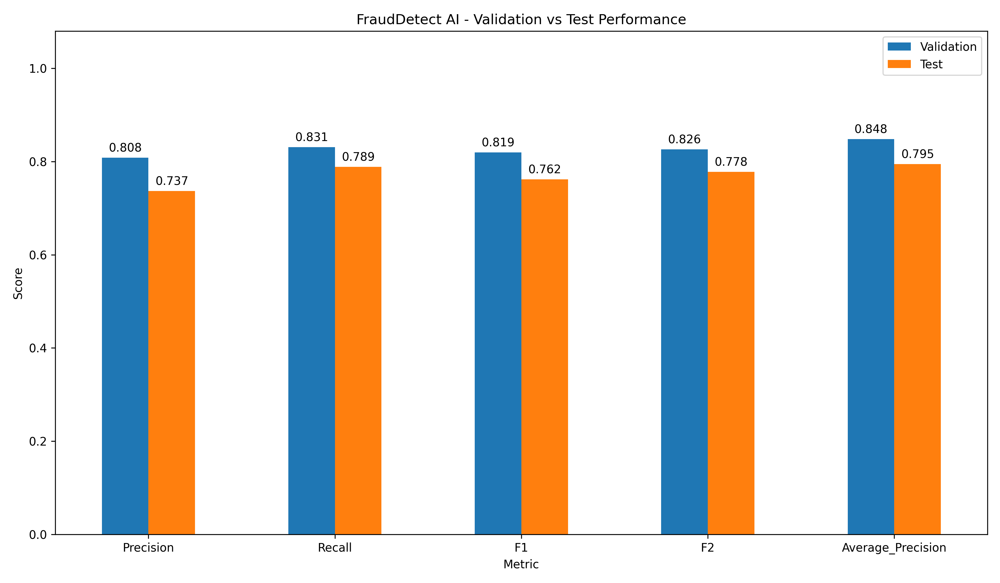

The final test performance was lower than the validation
performance, highlighting the importance of independent
model evaluation.

---

## 11. Hypothetical Financial Impact

A simplified cost-sensitive evaluation was performed
using the following illustrative assumptions:

- False positive cost: EUR 5
- False negative cost: EUR 500

Total cost = 5 * FP + 500 * FN

| Indicator | Default Threshold | Selected Threshold |
|---|---:|---:|
| Detected frauds | 54 | 56 |
| Missed frauds | 17 | 15 |
| False alerts | 9 | 20 |
| Hypothetical cost | EUR 8,545 | EUR 7,600 |

Estimated hypothetical cost reduction:

**EUR 945 (11.06%)**

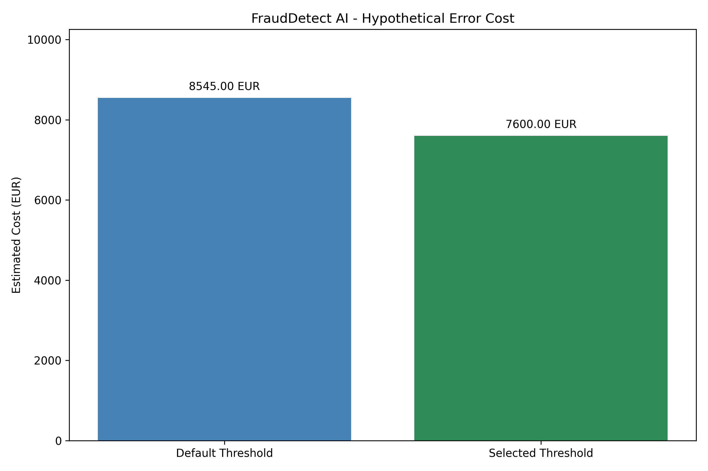

These costs are illustrative assumptions and do not
represent actual observed financial savings.

Threshold optimization improved fraud recall and
reduced hypothetical costs, while the test F2-score
remained approximately unchanged.

---

## 12. Project Structure

```text
FraudDetect/
|
|-- data/
|   |-- raw/
|   `-- processed/
|
|-- docs/
|   `-- PROJECT_SUMMARY.txt
|
|-- exports/
|   `-- frauddetect_v1/
|       |-- model.joblib
|       |-- scaler.joblib
|       |-- metadata.json
|       |-- feature_schema.json
|       |-- verification.json
|       `-- requirements.txt
|
|-- ml/
|   |-- check_dataset.py
|   |-- explore_dataset.py
|   |-- preprocessing.py
|   |-- balance_dataset.py
|   |-- train_logistic_regression.py
|   |-- train_decision_tree.py
|   |-- train_knn.py
|   |-- train_random_forest.py
|   |-- train_xgboost.py
|   |-- train_neural_network.py
|   |-- compare_models.py
|   |-- tune_xgboost.py
|   |-- tune_random_forest.py
|   |-- tune_neural_network.py
|   |-- compare_optimized_models.py
|   |-- tune_threshold.py
|   |-- evaluate_final_model.py
|   `-- export_final_model.py
|
|-- models/
|-- reports/
|-- .gitignore
|-- README.md
`-- requirements.txt
```

Raw datasets, processed datasets and experimental
model binaries are excluded from Git.

---

## 13. Installation

### Create a virtual environment

```bash
python -m venv .venv
```

Activate the environment on Windows:

```powershell
.venv\Scripts\Activate.ps1
```

Activate the environment on Linux or macOS:

```bash
source .venv/bin/activate
```

### Install dependencies

```bash
pip install -r requirements.txt
```

### Download the dataset

Download creditcard.csv from Kaggle and place it in:

```text
data/raw/creditcard.csv
```

The dataset is not included in this repository.

---

## 14. Reproducing the Experiments

### Data exploration and preprocessing

```bash
python ml/check_dataset.py
python ml/explore_dataset.py
python ml/preprocessing.py
python ml/balance_dataset.py
```

### Train the machine learning models

```bash
python ml/train_logistic_regression.py
python ml/train_decision_tree.py
python ml/train_knn.py
python ml/train_random_forest.py
python ml/train_xgboost.py
python ml/train_neural_network.py
```

### Initial benchmark

```bash
python ml/compare_models.py
```

### Hyperparameter optimization

```bash
python ml/tune_xgboost.py
python ml/tune_random_forest.py
python ml/tune_neural_network.py
```

### Final benchmark and threshold optimization

```bash
python ml/compare_optimized_models.py
python ml/tune_threshold.py
```

### Final evaluation and model export

```bash
python ml/evaluate_final_model.py
python ml/export_final_model.py
```

Training times and numerical results may vary depending
on hardware, library versions and random seeds.

---

## 15. Exported Model

The final Random Forest model is available in:

```text
exports/frauddetect_v1/
```

The export contains:

- Trained machine learning model
- Saved preprocessing scaler
- Decision threshold
- Feature schema
- Evaluation metrics
- Model parameters
- Environment information
- SHA-256 checksum
- Export verification report

### Prediction Example

The following example expects an already preprocessed
dataset with the same features used during training.

```python
import json
import joblib
import pandas as pd

from pathlib import Path

export_dir = Path("exports/frauddetect_v1")

with open(
    export_dir / "metadata.json",
    encoding="utf-8"
) as file:
    metadata = json.load(file)

model = joblib.load(
    export_dir / "model.joblib"
)

X = pd.read_csv(
    "data/processed/X_test.csv",
    nrows=10
)

X = X[metadata["feature_names"]]

fraud_index = list(model.classes_).index(1)

scores = model.predict_proba(X)[:, fraud_index]

predictions = (
    scores >= metadata["threshold"]
).astype(int)

results = pd.DataFrame({
    "Fraud_Score": scores,
    "Predicted_Class": predictions
})

print(results)
```

Run this example from the project root after generating
the processed dataset.

The exported model is intended for research and
educational purposes.

Only load trusted Joblib files.

---

## 16. Key Findings

The experiments highlight several important findings:

- No single algorithm performs best under every metric.
- Class balancing does not always improve performance.
- SMOTE is not universally superior to other strategies.
- Neural networks do not necessarily outperform
  traditional machine learning algorithms.
- Hyperparameter optimization does not guarantee
  improved validation performance.
- The default classification threshold is not always
  appropriate.
- Improvements on validation data do not necessarily
  translate into improvements on test data.
- Model selection should reflect the underlying
  objective and error costs.

---

## 17. Limitations

The project has several limitations:

- The V1-V28 features are anonymized PCA components.
- Their original business meaning is unavailable.
- The original PCA transformation is unavailable.
- The number of fraudulent test transactions is limited.
- Model scores have not been specifically calibrated.
- Financial costs are hypothetical.
- No external banking dataset was used for validation.

The model cannot directly process ordinary raw banking
transaction information without the required features
and preprocessing.

For this reason, the project intentionally focuses on
data science and machine learning rather than web
application development.

This project is not a production-ready banking system.

---

## 18. Future Improvements

Possible extensions include:

- Model explainability using SHAP
- Probability calibration
- External dataset validation
- Anomaly detection
- Cost-sensitive learning with real financial costs
- Concept drift analysis
- Experiments using interpretable business features

---

## 19. Documentation

A detailed project summary in French is available here:

[Project Summary](docs/PROJECT_SUMMARY.txt)

Additional experimental results and visualizations
are available in the reports directory.

---

## 20. Technologies

- Python
- NumPy
- Pandas
- Scikit-learn
- XGBoost
- Imbalanced-learn
- Matplotlib
- Seaborn
- Joblib
- Git
- GitHub

---

## Conclusion

FraudDetect AI demonstrates a complete experimental
machine learning workflow applied to a highly imbalanced
classification problem.

Through the comparison of 31 model configurations,
the project investigates the importance of data
preprocessing, class imbalance management, model
selection, hyperparameter optimization and decision
threshold tuning.

The final Random Forest model achieved a ROC-AUC of
95.04%, an Average Precision of 79.49% and a fraud
recall of 78.87% on the test dataset.

---

Personal Project | Data Science & Machine Learning | 2026
